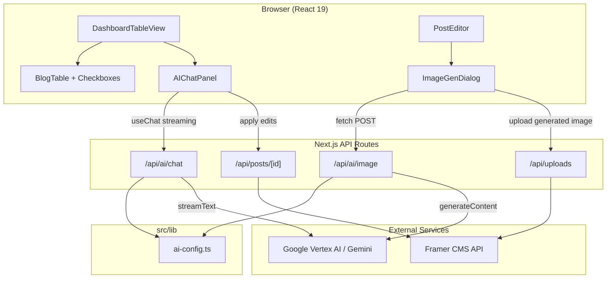

# Design Document: AI Super CMS

## Overview

This design adds four AI-powered capabilities to the existing FramerLink CMS dashboard:

1. **Multi-select rows** in the dashboard table for bulk operations
2. **Bulk AI editing chat panel** that uses a Gemini model to propose and apply field edits across selected rows
3. **AI image generation in post editor image fields** via a dialog with prompt input
4. **AI image generation in rich text content** with inline `` insertion

All AI interactions use the Vercel AI SDK (`ai`, `@ai-sdk/react`, `@ai-sdk/google-vertex`) with Gemini models through Google Vertex AI. No Imagen models are used. The existing Framer CMS pipeline, dashboard layout, and Notion bridge remain untouched.

### New Dependencies

| Package | Purpose |
|---|---|
| `ai` | Vercel AI SDK core (server-side `streamText`, `generateText`) |
| `@ai-sdk/react` | Client hooks (`useChat`) for streaming UI |
| `@ai-sdk/google-vertex` | Vertex AI provider for Gemini models |
| `ai-elements` (CLI) | Installs pre-built AI UI components into `src/components/ai-elements/` via `npx ai-elements@latest add` |

### AI Elements Components (installed via CLI, not npm)

AI Elements is a shadcn-style component registry from Vercel. Components are copied as source files into `src/components/ai-elements/` and are fully customizable. We use these for the AI Chat Panel:

| Component | Purpose | Used In |
|---|---|---|
| `Conversation` + `ConversationContent` | Chat container with auto-scrolling, empty state | `AIChatPanel` |
| `Message` + `MessageContent` + `MessageResponse` | Message bubbles with role-based styling, markdown rendering, syntax highlighting | `AIChatPanel` |
| `PromptInput` + `PromptInputTextarea` + `PromptInputSubmit` | Smart input with auto-resize, submit button | `AIChatPanel` |
| `Tool` + `ToolHeader` + `ToolInput` + `ToolOutput` | Displays tool call results (edit proposals) | `AIChatPanel` |
| `Loader` | Streaming loading indicator | `AIChatPanel` |

These components integrate directly with `useChat` from `@ai-sdk/react` — they consume `UIMessage` types, handle streaming states, and render tool invocations out of the box. This eliminates the need to build custom chat UI from scratch.

Install command: `npx ai-elements@latest add conversation message prompt-input tool loader`

### Environment Variables (user must add)

| Variable | Required | Description |
|---|---|---|
| `GOOGLE_CLOUD_PROJECT` | Yes (for AI) | GCP project ID for Vertex AI |
| `GOOGLE_CLOUD_LOCATION` | Yes (for AI) | Vertex AI region (e.g. `us-central1`) |
| `GEMINI_MODEL` | No | Model name override (default: `gemini-2.0-flash`) |

## Architecture



### Key Design Decisions

1. **Selection state lives in `DashboardTableView`** — a `Set<string>` of row IDs managed via `useState`. No global store needed since selection is scoped to the dashboard page.

2. **AI Chat Panel is a Sheet (slide-out)** — reuses the existing `Sheet` component from shadcn/ui, opening from the right side. This keeps the dashboard table visible for context.

3. **Single AI config module** (`src/lib/ai-config.ts`) — centralizes Vertex AI provider creation and model selection. Both the chat and image endpoints import from here.

4. **Image generation uses Gemini's multimodal capabilities** — Gemini models can generate images via text prompts. The generated image is returned as base64, converted to a File, and uploaded through the existing `/api/uploads` endpoint.

5. **No persistent conversation storage** — chat history lives in the `useChat` hook's client state. Closing the browser tab clears it. This matches Requirement 5.8.

6. **Bulk edits use existing `PUT /api/posts/[id]`** — the AI agent proposes edits as structured JSON, and the client applies them one-by-one through the existing update endpoint. No new batch endpoint needed.

7. **Leverage Vercel AI SDK built-in patterns and components** — use the SDK's built-in hooks, utilities, and patterns to accelerate development:
   - `useChat` hook from `@ai-sdk/react` handles the full chat lifecycle (message state, streaming, error handling, abort) out of the box — no custom WebSocket or SSE plumbing needed.
   - `streamText` from `ai` core handles server-side streaming with automatic protocol formatting that `useChat` consumes directly.
   - Use `@ai-sdk/react`'s built-in `data` channel to pass selected row context alongside messages (via `useChat`'s `body` option) instead of building a custom protocol.
   - Use `experimental_generateImage` from `ai` core for image generation with Gemini, which handles the multimodal request/response format.
   - Use the SDK's built-in `tool` definitions with `streamText` to let the AI agent propose structured edits via tool calls rather than parsing fenced JSON blocks from message content. This gives type-safe edit proposals with Zod schema validation built in.
   - The chat route follows the standard Vercel AI SDK route handler pattern (`POST` handler that returns `streamText(...).toDataStreamResponse()`) for zero-config streaming.

## Components and Interfaces

### New Files

```
src/
├── app/api/ai/
│   ├── chat/route.ts           # Streaming chat endpoint for bulk AI editing
│   └── image/route.ts          # Image generation endpoint
├── components/
│   ├── ai-elements/            # AI Elements components (installed via CLI, customizable source)
│   │   ├── conversation.tsx    # Chat container with auto-scroll
│   │   ├── message.tsx         # Message display with markdown rendering
│   │   ├── prompt-input.tsx    # Smart chat input with auto-resize
│   │   ├── tool.tsx            # Tool call display
│   │   └── loader.tsx          # Streaming loading indicator
│   ├── ai-chat-panel.tsx       # Slide-out chat panel (composes AI Elements)
│   ├── ai-image-dialog.tsx     # Shared image generation dialog
│   ├── edit-proposal-view.tsx  # Custom tool renderer for edit proposals
│   └── selection-toolbar.tsx   # Selection count + "AI Edit" button
├── lib/
│   └── ai-config.ts            # Vertex AI provider + model config
```

### Modified Files

| File | Changes |
|---|---|
| `src/lib/env.ts` | Add optional `GOOGLE_CLOUD_PROJECT`, `GOOGLE_CLOUD_LOCATION`, `GEMINI_MODEL` validation |
| `src/components/dashboard-table-view.tsx` | Add selection state, pass to `BlogTable`, render `SelectionToolbar` and `AIChatPanel` |
| `src/components/blog-table.tsx` | Add checkbox column, shift-click range selection, selected row highlighting |
| `src/components/post-editor.tsx` | Add "Generate Image" button to image fields, add toolbar button to rich text editor |

### Component Interfaces

#### SelectionToolbar

```typescript
interface SelectionToolbarProps {
  selectedCount: number;
  onAIEdit: () => void;
  onClearSelection: () => void;
}
```

Renders in the dashboard toolbar area when `selectedCount > 0`. Shows count badge and "AI Edit" button.

#### AIChatPanel

```typescript
interface AIChatPanelProps {
  open: boolean;
  onOpenChange: (open: boolean) => void;
  selectedPosts: BlogPostRecord[];
  metadata: BlogCollectionMetadata;
  onPostsUpdated: (updatedPosts: BlogPostRecord[]) => void;
}
```

Uses `useChat` from `@ai-sdk/react` to stream messages from `/api/ai/chat`. Built on top of AI Elements components:
- `Conversation` + `ConversationContent` for the scrollable chat container with auto-scroll
- `Message` + `MessageContent` + `MessageResponse` for rendering user/assistant messages with markdown
- `PromptInput` + `PromptInputTextarea` + `PromptInputSubmit` for the chat input
- `Tool` components for rendering the `propose_edits` tool call results as a change preview
- Custom "Apply Changes" button wired to the tool invocation output

The AI Elements components handle streaming states, message formatting, and tool call display automatically. We only need to add custom rendering for the edit proposal preview/apply flow on top of the `Tool` component.

#### AIImageDialog

```typescript
interface AIImageDialogProps {
  open: boolean;
  onOpenChange: (open: boolean) => void;
  defaultPrompt?: string;
  context?: {
    title?: string;
    slug?: string;
    bodyText?: string;
  };
  onAccept: (imageUrl: string, altText: string) => void;
}
```

Shared dialog used by both image field generation and rich text inline generation. Handles prompt input, generation request, preview, accept/regenerate flow.

### API Route Interfaces

#### POST /api/ai/chat

Streaming endpoint consumed by `useChat`. Receives messages array plus selected row data as system context.

```typescript
// Request body (handled by useChat automatically)
interface AIChatRequest {
  messages: Array<{ role: "user" | "assistant"; content: string }>;
  data?: {
    selectedRows: Array<{
      id: string;
      slug: string;
      title: string;
      fieldValues: Record<string, DashboardFieldValue>;
    }>;
    fieldDefinitions: Array<{
      id: string;
      name: string;
      type: DashboardFieldType;
    }>;
  };
}
```

The AI agent uses Vercel AI SDK `tool` definitions with `streamText` to propose structured edits via tool calls. This gives type-safe edit proposals with Zod schema validation built in — no manual JSON parsing from message content needed. The client uses `useChat`'s `toolInvocations` on messages to extract and render the change preview.

#### POST /api/ai/image

Non-streaming endpoint for image generation.

```typescript
interface AIImageRequest {
  prompt: string;
  referenceImageUrl?: string;
  context?: {
    title?: string;
    slug?: string;
    bodyText?: string;
  };
}

interface AIImageResponse {
  imageBase64: string;
  mimeType: string;
}
```

Returns the generated image as base64. The client converts it to a `File` and uploads via `/api/uploads`.

## Data Models

### Selection State

```typescript
// Managed in DashboardTableView via useState
type SelectionState = Set<string>; // Set of BlogPostRecord.id values
```

Selection is purely client-side. It persists across pagination and search changes within the same page session.

### AI Chat Tool Calls for Edit Proposals

The `streamText` call defines a `propose_edits` tool with a Zod schema. The AI agent invokes this tool to propose structured edits. The client reads `toolInvocations` from assistant messages to render the change preview UI.

```typescript
// Tool definition in /api/ai/chat/route.ts
const proposeEditsTool = tool({
  description: "Propose field edits for selected CMS rows",
  parameters: z.object({
    edits: z.array(z.object({
      rowId: z.string(),
      changes: z.record(z.object({
        fieldName: z.string(),
        currentValue: z.unknown(),
        proposedValue: z.unknown(),
      })),
    })),
  }),
});

// Client reads from message.toolInvocations
interface ProposedEdit {
  rowId: string;
  changes: Record<string, {
    fieldName: string;
    currentValue: DashboardFieldValue;
    proposedValue: DashboardFieldValue;
  }>;
}
```

This approach leverages the Vercel AI SDK's built-in tool call mechanism instead of parsing fenced JSON blocks from message content.

### AI Config

```typescript
// src/lib/ai-config.ts
interface AIConfig {
  provider: ReturnType<typeof createVertex>;
  textModel: string;
  imageModel: string;
}
```

Reads from validated env vars. Returns 503 if Vertex AI credentials are missing.

### Environment Schema Extension

```typescript
// Added to src/lib/env.ts
const aiEnvSchema = z.object({
  GOOGLE_CLOUD_PROJECT: z.string().optional(),
  GOOGLE_CLOUD_LOCATION: z.string().optional(),
  GEMINI_MODEL: z.string().optional(),
});
```

### Wide Events

| Event Name | Context Fields |
|---|---|
| `dashboard.rows.selected` | `count` |
| `ai.bulk_edit.requested` | `selectedRowCount`, `messageLength`, `model` |
| `ai.bulk_edit.completed` | `editedCount`, `failedCount`, `durationMs` |
| `ai.image_gen.requested` | `promptLength`, `sourceFieldId`, `model` |
| `ai.image_gen.completed` | `durationMs`, `success` |
| `ai.image_gen.inline.requested` | `promptLength`, `contentLength`, `hasReferenceImage` |
| `ai.image_gen.inline.completed` | `durationMs`, `success` |


## Correctness Properties

*A property is a characteristic or behavior that should hold true across all valid executions of a system — essentially, a formal statement about what the system should do. Properties serve as the bridge between human-readable specifications and machine-verifiable correctness guarantees.*

### Property 1: Checkbox toggle is an involution

*For any* selection state (a set of row IDs) and *for any* row ID, toggling the checkbox for that row should flip its membership: if the ID was in the set it is removed, if it was not in the set it is added. Toggling twice returns to the original state.

**Validates: Requirements 1.3**

### Property 2: Header checkbox toggles all-or-none

*For any* list of visible row IDs and *for any* current selection state, clicking the header checkbox should produce: if the selection was empty, the new selection equals the full set of visible IDs; otherwise, the new selection is empty. This subsumes the edge case where zero rows are selected (Requirement 1.4).

**Validates: Requirements 1.4, 1.5**

### Property 3: Selection count display matches state

*For any* selection state with one or more IDs, the displayed count in the toolbar should equal the size of the selection set. When the selection is empty, no count is displayed.

**Validates: Requirements 1.6**

### Property 4: Selection persists across page/search changes

*For any* selection state and *for any* page navigation or search query change, all previously selected row IDs remain in the selection set after the change.

**Validates: Requirements 1.7**

### Property 5: Shift-click range selection

*For any* ordered list of visible rows, *for any* last-individually-selected index `a`, and *for any* shift-clicked index `b`, all rows between `min(a, b)` and `max(a, b)` inclusive should be added to the selection state.

**Validates: Requirements 1.9**

### Property 6: AI Edit button enabled iff selection non-empty

*For any* selection state, the "AI Edit" button is enabled if and only if the selection contains at least one row ID.

**Validates: Requirements 2.1**

### Property 7: Chat panel context matches selection

*For any* set of selected posts, the AI Chat Panel header should display a count equal to the number of selected posts, and should display a (possibly truncated) title for each selected post.

**Validates: Requirements 2.3**

### Property 8: Edit proposal JSON round-trip parsing

*For any* valid proposed-edit JSON block (mapping row IDs to field changes), parsing the block from the assistant message content should produce a structured array of `ProposedEdit` objects where each row ID and field change is preserved exactly.

**Validates: Requirements 2.8**

### Property 9: Change preview completeness

*For any* set of proposed edits, the preview UI should render exactly one entry per affected row, and each entry should display the field name, current value, and proposed value for every changed field.

**Validates: Requirements 2.9**

### Property 10: Partial failure resilience in bulk apply

*For any* set of N proposed edits where K of them fail (0 ≤ K ≤ N), the system should attempt all N updates, successfully apply N − K of them, and report exactly K failures with their error messages.

**Validates: Requirements 2.13**

### Property 11: Image dialog pre-populates prompt from CMS item

*For any* CMS item with a non-empty title and slug, the image generation dialog's default prompt should contain both the title and slug values.

**Validates: Requirements 3.3**

### Property 12: Rich text image dialog shows CMS context

*For any* CMS item with title, slug, and body text, the rich text image generation dialog should display all three values as reference context.

**Validates: Requirements 4.3**

### Property 13: Inserted image alt text derived from prompt

*For any* generation prompt string, the `` element inserted into the rich text editor should have an `alt` attribute whose value is derived from the prompt text.

**Validates: Requirements 4.11**

### Property 14: AI config reads environment variables correctly

*For any* set of environment variable values for `GOOGLE_CLOUD_PROJECT`, `GOOGLE_CLOUD_LOCATION`, and `GEMINI_MODEL`, the AI config module should return a config object where the project, location, and model fields match the provided env values (with `GEMINI_MODEL` defaulting to `gemini-2.0-flash` when not set).

**Validates: Requirements 5.2, 5.4**

### Property 15: Missing Vertex AI env returns 503

*For any* request to an AI endpoint (chat or image), if either `GOOGLE_CLOUD_PROJECT` or `GOOGLE_CLOUD_LOCATION` is missing or empty, the endpoint should return HTTP 503 with a descriptive error message.

**Validates: Requirements 5.5**

## Error Handling

### AI Endpoint Errors

| Scenario | Behavior |
|---|---|
| Missing Vertex AI env vars | Return 503 with message: "AI features require GOOGLE_CLOUD_PROJECT and GOOGLE_CLOUD_LOCATION environment variables." |
| Gemini model request fails (network/quota) | Return 502 with the upstream error message. Log `ai.bulk_edit.completed` or `ai.image_gen.completed` with `success: false`. |
| Invalid request body (missing prompt, bad JSON) | Return 400 with Zod validation error details. |
| Image generation returns no image data | Return 502 with message: "The model did not return an image. Try a different prompt." |

### Bulk Edit Apply Errors

| Scenario | Behavior |
|---|---|
| Single row update fails (409 slug conflict, 404 not found) | Skip that row, continue with remaining rows. Collect the error. |
| All rows fail | Report all failures to the user. No partial state corruption since each update is independent. |
| Network failure during apply | Show error toast, allow retry of the entire batch. |

### Client-Side Error Handling

- `useChat` `onError` callback displays error in the chat panel as a system message
- Image generation dialog catches fetch errors and displays them inline with a "Retry" button
- All errors are non-destructive — the user can always dismiss and try again

### Logging

All errors are logged as wide events via `logError()` with the relevant event name and contextual metadata. This follows the existing pattern in `src/lib/logger.ts`.

## Testing Strategy

### Dual Testing Approach

This feature uses both unit tests and property-based tests:

- **Unit tests**: Verify specific examples, edge cases, error conditions, and integration points
- **Property tests**: Verify universal properties across randomly generated inputs

Both are complementary. Unit tests catch concrete bugs at specific values; property tests verify general correctness across the input space.

### Property-Based Testing Configuration

- **Library**: `fast-check` (the standard PBT library for TypeScript/Node.js)
- **Runner**: Node built-in test runner (`node --import tsx --test`)
- **Minimum iterations**: 100 per property test
- **Each property test must reference its design document property** with a comment tag:
  ```
  // Feature: ai-super-cms, Property 1: Checkbox toggle is an involution
  ```
- **Each correctness property is implemented by a single property-based test**

### Test Plan

#### Unit Tests (specific examples and edge cases)

- `ai-config.ts`: Default model name when `GEMINI_MODEL` is unset; 503 error when env vars missing
- `/api/ai/chat`: Request validation; system prompt includes selected row data; error response format
- `/api/ai/image`: Request validation; handles missing prompt; handles reference image URL; error response format
- Edit proposal parsing: Malformed JSON blocks; empty edit arrays; missing fields
- Selection state: Empty selection; single item; header checkbox with full page selected
- Wide event emission: Correct event names and metadata fields for each AI operation

#### Property Tests (universal properties)

| Property | Test File | What It Generates |
|---|---|---|
| P1: Checkbox toggle involution | `src/lib/selection.test.ts` | Random sets of IDs + random toggle target |
| P2: Header checkbox all-or-none | `src/lib/selection.test.ts` | Random visible ID lists + random selection states |
| P3: Selection count display | `src/lib/selection.test.ts` | Random selection states |
| P4: Selection persistence | `src/lib/selection.test.ts` | Random selection states + random page changes |
| P5: Shift-click range | `src/lib/selection.test.ts` | Random row lists + random index pairs |
| P6: AI Edit button enabled | `src/lib/selection.test.ts` | Random selection states |
| P7: Chat panel context | `src/components/ai-chat-panel.test.ts` | Random post arrays |
| P8: Edit JSON round-trip | `src/lib/ai-edit-parser.test.ts` | Random edit proposal objects |
| P9: Preview completeness | `src/lib/ai-edit-parser.test.ts` | Random edit proposals |
| P10: Partial failure resilience | `src/lib/ai-bulk-apply.test.ts` | Random edit sets with random failure indices |
| P11: Image prompt pre-population | `src/lib/ai-image-prompt.test.ts` | Random title/slug strings |
| P12: Rich text context display | `src/lib/ai-image-prompt.test.ts` | Random title/slug/body strings |
| P13: Img alt from prompt | `src/lib/ai-image-prompt.test.ts` | Random prompt strings |
| P14: AI config env reading | `src/lib/ai-config.test.ts` | Random env var combinations |
| P15: Missing env returns 503 | `src/lib/ai-config.test.ts` | Random requests with missing env vars |

### Testing Boundaries

- AI model responses are not tested (non-deterministic). Tests mock the Vercel AI SDK calls.
- Framer API calls are mocked in tests using the existing DI pattern from `post-route-logic.ts`.
- DOM/React component rendering tests are out of scope for property tests but covered by unit tests where needed.
