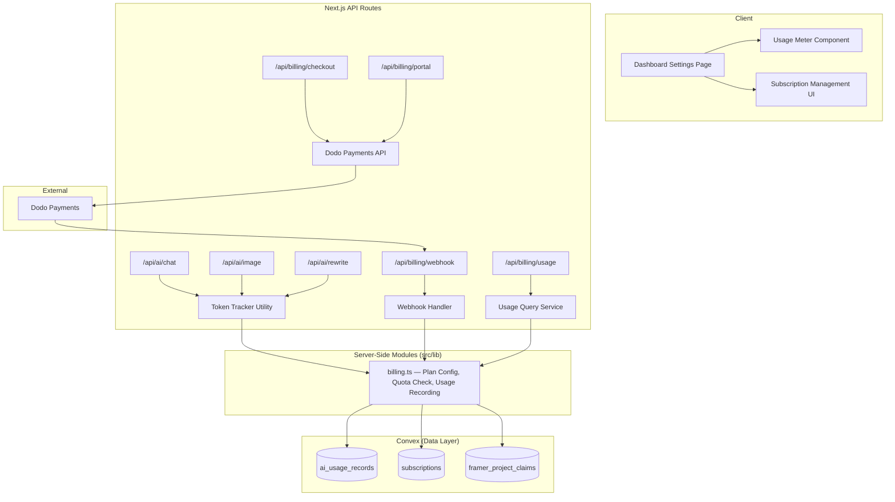

# Design Document: AI Usage Billing

## Overview

This design describes a token-based AI usage billing and metering system for FramerLink. The system tracks token consumption across all AI features (chat, image generation, rewrite, image tool calls), enforces monthly allowances tied to Organization-scoped subscription plans, and presents usage to users as a friendly percentage meter. Dodo Payments acts as the Merchant of Record for subscriptions, metered billing, and global payment processing.

Key design goals:
- All billing and quota enforcement is Organization-scoped (Clerk org), not per-user
- Token usage is recorded after every AI response via a shared `trackTokenUsage` utility
- Quota gating happens before AI requests proceed, with a soft-cap approach
- Plan definitions live in a single `PLAN_CONFIG` constant — the sole source of truth
- The Framer project uniqueness constraint prevents Free-tier abuse across Organizations
- Usage is presented as a percentage meter, never raw token counts

### Reference

- [Requirements Document](./requirements.md)

## Architecture



The system introduces three new Convex tables and a handful of new API routes. The core billing logic lives in `src/lib/billing.ts` — a server-side module that owns plan configuration, quota checking, usage recording, and Dodo Payments integration. AI routes (`/api/ai/chat`, `/api/ai/image`, `/api/ai/rewrite`) are modified to call a shared `trackTokenUsage` function after each response and a `checkQuota` function before processing.

## Components and Interfaces

### 1. Plan Configuration (`src/lib/billing.ts`)

A single exported `PLAN_CONFIG` constant defines all plans:

```typescript
export const PLAN_CONFIG = {
  free: {
    id: "free",
    name: "Free",
    priceMonthly: 0,
    monthlyTokenAllowance: 100_000,
    dodoProductId: null, // No Dodo product for free tier
  },
  pro: {
    id: "pro",
    name: "Pro",
    priceMonthly: 8,
    monthlyTokenAllowance: 10_000_000,
    dodoProductId: process.env.DODO_PRO_PRODUCT_ID ?? "",
  },
} as const;
```

A helper `getPlanById(planId: string)` resolves a plan from this config or returns `undefined` for unknown IDs.

### 2. Token Tracker (`src/lib/billing.ts` — `trackTokenUsage`)

A shared async function called after every AI response:

```typescript
async function trackTokenUsage(params: {
  organizationId: string;
  userId: string;
  featureType: "chat" | "image" | "image_tool" | "rewrite";
  promptTokens: number;
  completionTokens: number;
  totalTokens: number;
  model: string;
  conversationId?: string;
}): Promise<void>
```

- Inserts a record into the `ai_usage_records` Convex table
- Fires a wide event via `logEvent` on success
- On failure: logs a wide event error via `logError` and does NOT throw (non-blocking)

For image generation, when the model reports `usage.promptTokens` and `usage.completionTokens`, those values are used directly. When the model does not report usage, a `FALLBACK_IMAGE_TOKEN_COST` constant (e.g., 1000 tokens) is applied.

### 3. Quota Checker (`src/lib/billing.ts` — `checkQuota`)

Called before every AI request:

```typescript
async function checkQuota(organizationId: string): Promise<{
  allowed: boolean;
  currentUsage: number;
  allowance: number;
  percentUsed: number;
}>
```

- Queries the Organization's subscription to determine the active plan and billing cycle dates
- If no subscription exists, uses `PLAN_CONFIG.free` allowance
- Aggregates total tokens consumed by the Organization in the current billing cycle from `ai_usage_records`
- Returns `allowed: true` if `currentUsage < allowance` (soft cap — allows the request to start even if remaining allowance is less than expected cost)
- Logs a wide event for every check (allowed or rejected)

### 4. Webhook Handler (`src/app/api/billing/webhook/route.ts`)

Processes Dodo Payments webhook events:

- Validates webhook signature using `DODO_WEBHOOK_SECRET` env var
- Handles events: `subscription.active`, `subscription.cancelled`, `subscription.expired`, `subscription.updated`
- Resolves plan allowance from `PLAN_CONFIG` using the plan ID from the webhook payload
- Upserts the `subscriptions` Convex table (one record per Organization)
- Idempotent — re-processing the same event produces the same result
- Responds with 200 within 5 seconds; logs wide events for every webhook received
- Rejects unknown plan IDs with a wide event error (does not update subscription)
- Returns 200 for unknown organizations (prevents Dodo retries) with a warning log

### 5. Checkout & Portal Routes

- `POST /api/billing/checkout` — Creates a Dodo Payments checkout session for the Pro plan, redirects to hosted checkout. Associates the subscription with the requesting user's Organization.
- `POST /api/billing/portal` — Creates a Dodo Payments customer portal session for subscription management (payment methods, plan changes, cancellation). Redirects to the portal URL.

Both routes require Clerk auth and admin role.

### 6. Usage Query Route (`GET /api/billing/usage`)

Returns the Organization's current billing cycle usage:

```typescript
{
  percentUsed: number;        // e.g., 34
  currentUsage: number;       // total tokens consumed this cycle
  allowance: number;          // monthly token allowance
  planName: string;           // "Free" or "Pro"
  byFeature: {                // breakdown by feature type
    chat: number;
    image: number;
    image_tool: number;
    rewrite: number;
  };
  byUser: Array<{             // per-user breakdown
    userId: string;
    totalTokens: number;
  }>;
  cycleStart: string;         // ISO date
  cycleEnd: string;           // ISO date
}
```

### 7. Usage Meter UI Component (`src/components/usage-meter.tsx`)

A client component displayed on the settings page:

- Shows a percentage progress bar with the Organization's aggregate usage
- Friendly copy: "Your team has used 34% of this month's AI allowance"
- Warning state (amber) at >80% usage
- Exhausted state (red) at 100% usage
- When no subscription exists, shows a "Subscribe to Pro" CTA with link to checkout
- Fetches usage data via `GET /api/billing/usage` on mount (no full page reload needed)
- Uses shadcn/ui `Progress` component + phosphor icons

### 8. Subscription Management UI (Settings Page)

Added to the existing `src/app/dashboard/settings/page.tsx`:

- Displays current plan name, status, renewal date, and monthly allowance
- "Manage Subscription" button → redirects to Dodo Payments customer portal
- "Subscribe" button (when no active subscription) → redirects to Dodo checkout
- Admin-only: subscription management actions are hidden for non-admin users
- Non-admin users see the usage meter but not the management controls

### 9. Framer Project Uniqueness Enforcement

During onboarding (`/api/onboarding/complete`), before saving the site setup:

- Query the `framer_project_claims` Convex table to check if the Framer project ID is already claimed by another Organization
- If claimed: reject with a descriptive error
- If available: atomically insert the claim record
- When an Organization disconnects/switches projects: remove the old claim
- Wide event logging on rejected claims

### 10. Metered Usage Reporting to Dodo Payments

A server-side function (callable via cron or API route) that reports aggregated Organization-level token usage to the Dodo Payments metered billing API at the end of each billing cycle:

- Sends total tokens consumed by all members during the billing period
- Retries with exponential backoff on failure
- Logs wide events for every report (success and failure)

## Data Models

### New Convex Tables

Added to `convex/schema.ts`:

#### `aiUsageRecords`

Stores individual token consumption records.

```typescript
aiUsageRecords: defineTable({
  clerkOrganizationId: v.string(),
  clerkUserId: v.string(),
  featureType: v.union(
    v.literal("chat"),
    v.literal("image"),
    v.literal("image_tool"),
    v.literal("rewrite"),
  ),
  promptTokens: v.number(),
  completionTokens: v.number(),
  totalTokens: v.number(),
  model: v.string(),
  conversationId: v.optional(v.string()),
  createdAt: v.number(),
})
  .index("by_org_period", ["clerkOrganizationId", "createdAt"])
  .index("by_org_user_period", ["clerkOrganizationId", "clerkUserId", "createdAt"])
```

- `by_org_period` — used for Organization-level aggregate queries (quota checks, usage meter)
- `by_org_user_period` — used for per-user breakdowns

#### `subscriptions`

Stores Organization subscription state. One record per Organization.

```typescript
subscriptions: defineTable({
  clerkOrganizationId: v.string(),
  dodoSubscriptionId: v.string(),
  dodoCustomerId: v.string(),
  planId: v.string(),
  status: v.union(
    v.literal("active"),
    v.literal("cancelled"),
    v.literal("expired"),
    v.literal("past_due"),
  ),
  monthlyTokenAllowance: v.number(),
  currentPeriodStart: v.number(),
  currentPeriodEnd: v.number(),
  updatedAt: v.number(),
})
  .index("by_org", ["clerkOrganizationId"])
  .index("by_dodo_subscription", ["dodoSubscriptionId"])
```

- `by_org` — lookup subscription by Organization (enforces one-per-org at application level)
- `by_dodo_subscription` — lookup by Dodo subscription ID for webhook processing

#### `framerProjectClaims`

Enforces the one-project-per-Organization uniqueness constraint.

```typescript
framerProjectClaims: defineTable({
  framerProjectId: v.string(),
  clerkOrganizationId: v.string(),
  claimedAt: v.number(),
})
  .index("by_project", ["framerProjectId"])
  .index("by_org", ["clerkOrganizationId"])
```

- `by_project` — uniqueness check: is this Framer project already claimed?
- `by_org` — find the claim for a given Organization (for release/disconnect)

### Environment Variables (New)

The user will need to add these to their `.env` file:

| Variable | Purpose |
|---|---|
| `DODO_API_KEY` | Dodo Payments API key for server-side calls |
| `DODO_WEBHOOK_SECRET` | Secret for verifying Dodo webhook signatures |
| `DODO_PRO_PRODUCT_ID` | Dodo Payments product ID for the Pro plan |
| `DODO_BUSINESS_ID` | Dodo Payments business ID |

These will be validated in `src/lib/env.ts` using the existing Zod pattern — optional (billing features degrade gracefully when not configured, similar to how AI features work without Vertex AI vars).


## Correctness Properties

*A property is a characteristic or behavior that should hold true across all valid executions of a system — essentially, a formal statement about what the system should do. Properties serve as the bridge between human-readable specifications and machine-verifiable correctness guarantees.*

### Property 1: Usage recording round trip

*For any* valid usage parameters (organizationId, userId, featureType in {chat, image, image_tool, rewrite}, promptTokens, completionTokens, totalTokens, model, optional conversationId), calling `trackTokenUsage` and then querying the usage records for that Organization should return a record with all fields matching the input parameters.

**Validates: Requirements 1.1, 1.2, 1.3, 1.5, 9.1, 9.2**

### Property 2: Organization-level usage aggregation

*For any* set of usage records belonging to the same Organization within a billing cycle, the aggregate usage returned by the billing service should equal the sum of `totalTokens` across all records in that cycle, regardless of which users created them.

**Validates: Requirements 2.1**

### Property 3: Billing cycle date calculation

*For any* subscription with a `currentPeriodStart` and `currentPeriodEnd`, and any timestamp within that range, the billing cycle calculation should return the correct start and end dates that contain that timestamp. For Organizations with no subscription, the cycle should default to calendar-month boundaries.

**Validates: Requirements 2.2**

### Property 4: Usage percentage calculation

*For any* non-zero monthly allowance and any non-negative current usage value, the percentage calculation should equal `Math.min(100, Math.round((currentUsage / allowance) * 100))`, and the percentage should always be between 0 and 100 inclusive.

**Validates: Requirements 2.3**

### Property 5: Usage breakdowns sum to total

*For any* set of usage records for an Organization in a billing cycle, the sum of the per-feature-type breakdown (chat + image + image_tool + rewrite) should equal the Organization-level total, and the sum of the per-user breakdown should also equal the Organization-level total.

**Validates: Requirements 2.4, 2.5**

### Property 6: Quota check correctness

*For any* Organization with a known aggregate usage and monthly allowance, `checkQuota` should return `allowed: true` when `currentUsage < allowance` and `allowed: false` when `currentUsage >= allowance`. This holds regardless of how many individual users contributed to the aggregate.

**Validates: Requirements 3.1, 3.2, 3.5**

### Property 7: Webhook subscription state update

*For any* valid Dodo Payments webhook event with a plan ID that exists in `PLAN_CONFIG`, processing the webhook should result in a subscription record whose `monthlyTokenAllowance` matches `PLAN_CONFIG[planId].monthlyTokenAllowance`. For cancellation/expiration events, the allowance should be set to 0.

**Validates: Requirements 4.3, 4.4, 4.5, 11.4**

### Property 8: Webhook idempotence

*For any* valid Dodo Payments webhook event, processing it N times (N >= 1) should produce the same subscription state as processing it exactly once.

**Validates: Requirements 4.7**

### Property 9: One subscription per Organization

*For any* Organization, after processing any sequence of webhook events (active, updated, cancelled, expired), there should be at most one subscription record for that Organization in the data store.

**Validates: Requirements 4.9**

### Property 10: Webhook signature validation

*For any* webhook payload and secret, computing the signature and validating it should succeed. Mutating any byte of the payload or signature should cause validation to fail.

**Validates: Requirements 8.1**

### Property 11: Usage meter state derivation

*For any* usage percentage value, the meter state should be "normal" when percentage < 80, "warning" when 80 <= percentage < 100, and "exhausted" when percentage >= 100.

**Validates: Requirements 6.2, 6.3**

### Property 12: Plan config lookup

*For any* plan ID that exists in `PLAN_CONFIG`, `getPlanById` should return the corresponding plan object with the correct name, price, and monthly token allowance. *For any* plan ID that does not exist in `PLAN_CONFIG`, `getPlanById` should return `undefined`.

**Validates: Requirements 11.3**

### Property 13: Framer project uniqueness

*For any* Framer project ID and two distinct Organization IDs, if the first Organization successfully claims the project, the second Organization's claim attempt should be rejected. The project should be associated with exactly one Organization at any time.

**Validates: Requirements 12.1, 12.2, 12.3**

### Property 14: Framer project claim-release round trip

*For any* Framer project ID and Organization, claiming the project and then releasing it should make the project available for another Organization to claim successfully.

**Validates: Requirements 12.4**

### Property 15: Admin-only subscription management

*For any* user role, the subscription management actions (subscribe, manage, cancel) should be visible if and only if the role is "admin". Non-admin users should see usage information but not management controls.

**Validates: Requirements 7.4, 7.5**

## Error Handling

| Scenario | Behavior |
|---|---|
| `trackTokenUsage` fails (Convex write error) | Log wide event error, swallow exception — AI response proceeds unblocked (Req 1.6) |
| Quota check fails (Convex read error) | Log wide event error, allow the request to proceed (fail-open to avoid blocking users on transient DB issues) |
| Dodo webhook with invalid signature | Return 401, log wide event warning (Req 8.1, 8.2) |
| Dodo webhook with unknown organization | Return 200 (prevent retries), log wide event warning (Req 8.5) |
| Dodo webhook with unknown plan ID | Return 200, log wide event error, do NOT update subscription (Req 11.5) |
| Dodo checkout session creation fails | Return 502 to client with descriptive error, log wide event error |
| Dodo portal session creation fails | Return 502 to client with descriptive error, log wide event error |
| Dodo metered usage report fails | Retry with exponential backoff (max 3 attempts), log each failure (Req 5.3) |
| Image generation with no reported token usage | Apply `FALLBACK_IMAGE_TOKEN_COST` constant (Req 9.3) |
| Framer project ID already claimed | Return 409 with descriptive error message, log wide event (Req 12.2, 12.6) |
| Billing env vars not configured | Billing features degrade gracefully — AI routes work without billing, usage meter shows "not configured" state |
| Organization at 100% quota | Return 429 with message "Your organization's AI allowance has been exhausted this month" (Req 3.2) |

## Testing Strategy

### Unit Tests

Unit tests verify specific examples, edge cases, and error conditions:

- `PLAN_CONFIG` contains exactly two plans (free, pro) with correct allowances and prices (Req 11.2)
- `getPlanById("free")` returns the free plan; `getPlanById("unknown")` returns undefined
- `trackTokenUsage` swallows errors and does not throw when Convex write fails (Req 1.6)
- Quota check returns free-tier allowance when no subscription exists (Req 2.6, 3.3)
- Webhook handler returns 200 for unknown organizations (Req 8.5)
- Webhook handler rejects unknown plan IDs without updating subscription (Req 11.5)
- Image token normalization uses fallback cost when model reports no usage (Req 9.3)
- Usage meter component renders subscribe CTA when no subscription exists (Req 6.5)

### Property-Based Tests

Property-based tests verify universal properties across randomly generated inputs. The project already uses `fast-check` (installed as a dev dependency) with the Node built-in test runner.

Each property test must:
- Run a minimum of 100 iterations
- Reference its design document property in a comment tag
- Use the format: `// Feature: ai-usage-billing, Property {number}: {title}`

Properties to implement as PBT:

1. **Usage recording round trip** — Generate random usage params, call trackTokenUsage, verify stored record matches (Property 1)
2. **Organization-level usage aggregation** — Generate random sets of usage records for multiple users in one org, verify aggregate equals sum (Property 2)
3. **Billing cycle date calculation** — Generate random subscription dates and timestamps, verify cycle boundaries (Property 3)
4. **Usage percentage calculation** — Generate random usage/allowance pairs, verify percentage formula (Property 4)
5. **Usage breakdowns sum to total** — Generate random records with mixed feature types and users, verify both breakdowns sum to total (Property 5)
6. **Quota check correctness** — Generate random usage/allowance pairs, verify allowed=(usage < allowance) (Property 6)
7. **Webhook subscription state update** — Generate random webhook payloads with valid plan IDs, verify resulting allowance matches PLAN_CONFIG (Property 7)
8. **Webhook idempotence** — Generate random webhooks, process N times, verify state equals single-processing state (Property 8)
9. **One subscription per org** — Generate random webhook sequences for one org, verify at most one subscription record (Property 9)
10. **Webhook signature validation** — Generate random payloads, compute valid signatures, verify acceptance; mutate and verify rejection (Property 10)
11. **Usage meter state derivation** — Generate random percentages 0-200, verify correct state (normal/warning/exhausted) (Property 11)
12. **Plan config lookup** — Generate random plan IDs (mix of valid and invalid), verify correct return values (Property 12)
13. **Framer project uniqueness** — Generate random org/project pairs, verify only first claim succeeds (Property 13)
14. **Framer project claim-release round trip** — Generate random claims, release, verify re-claimable (Property 14)
15. **Admin-only subscription management** — Generate random roles, verify visibility matches admin check (Property 15)
